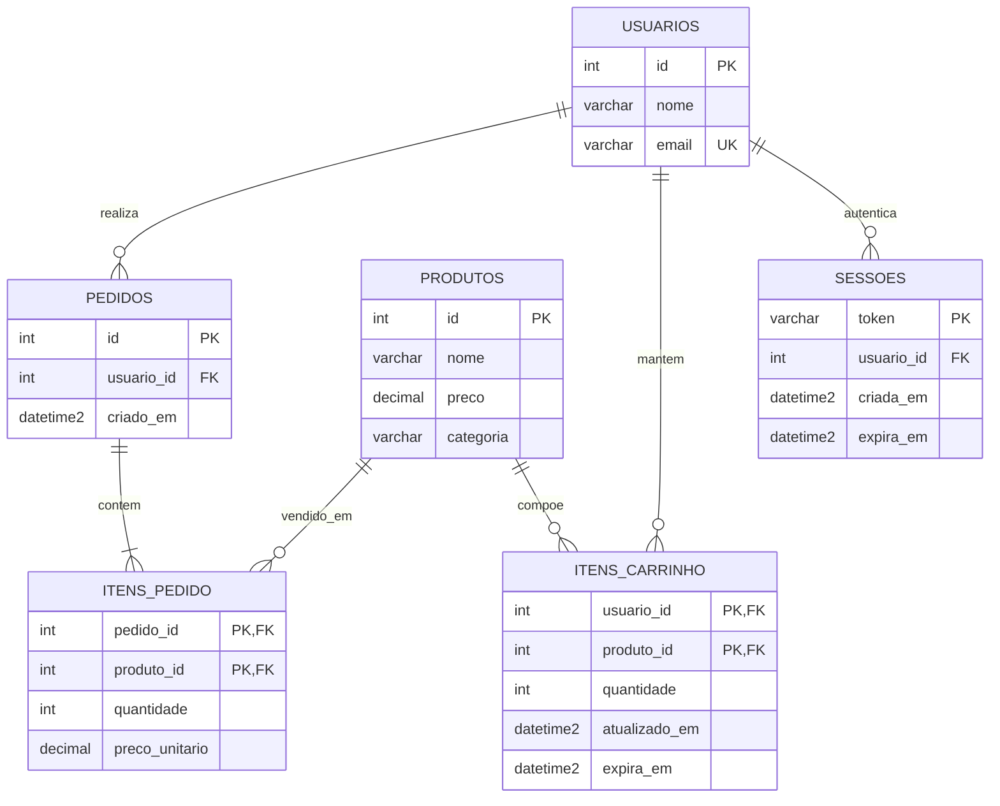

# Comparativo com o modelo relacional

Para comparar o Redis com um banco de dados relacional (**SQL Server**), modelamos o mesmo cenário de sessão de login, carrinho de compras e ranking de vendas da peixaria em T-SQL (arquivo completo em [`scripts/esquema.sql`](../scripts/esquema.sql)).

## 1. Modelo relacional (Diagrama ER e criação das tabelas)

No modelo relacional, relacionamentos são garantidos por chaves estrangeiras (`FOREIGN KEY`), a validade das sessões e carrinhos precisa ser controlada manualmente por colunas de data (`expira_em`), e o ranking de vendas é obtido somando os itens dos pedidos fechados (`itens_pedido`).

### Diagrama Entidade-Relacionamento (ER)



### Criação das tabelas (`CREATE TABLE` — SQL Server)

```sql
CREATE TABLE usuarios (
    id INT IDENTITY(1,1) PRIMARY KEY,
    nome VARCHAR(120) NOT NULL,
    email VARCHAR(150) NOT NULL UNIQUE
);

CREATE TABLE produtos (
    id INT IDENTITY(1,1) PRIMARY KEY,
    nome VARCHAR(120) NOT NULL,
    preco DECIMAL(10, 2) NOT NULL CHECK (preco >= 0),
    categoria VARCHAR(50) NOT NULL
);

CREATE TABLE sessoes (
    token VARCHAR(64) PRIMARY KEY,
    usuario_id INT NOT NULL REFERENCES usuarios(id) ON DELETE CASCADE,
    criada_em DATETIME2 NOT NULL DEFAULT GETDATE(),
    expira_em DATETIME2 NOT NULL
);

CREATE INDEX idx_sessoes_expira_em ON sessoes(expira_em);

CREATE TABLE itens_carrinho (
    usuario_id INT NOT NULL REFERENCES usuarios(id) ON DELETE CASCADE,
    produto_id INT NOT NULL REFERENCES produtos(id) ON DELETE CASCADE,
    quantidade INT NOT NULL CHECK (quantidade > 0),
    atualizado_em DATETIME2 NOT NULL DEFAULT GETDATE(),
    expira_em DATETIME2 NOT NULL,
    PRIMARY KEY (usuario_id, produto_id)
);

CREATE TABLE pedidos (
    id INT IDENTITY(1,1) PRIMARY KEY,
    usuario_id INT NOT NULL REFERENCES usuarios(id),
    criado_em DATETIME2 NOT NULL DEFAULT GETDATE()
);

CREATE TABLE itens_pedido (
    pedido_id INT NOT NULL REFERENCES pedidos(id) ON DELETE CASCADE,
    produto_id INT NOT NULL REFERENCES produtos(id),
    quantidade INT NOT NULL CHECK (quantidade > 0),
    preco_unitario DECIMAL(10, 2) NOT NULL,
    PRIMARY KEY (pedido_id, produto_id)
);

CREATE INDEX idx_itens_pedido_produto ON itens_pedido(produto_id);
```

---

## 2. Duas das 5 consultas reescritas em SQL (SQL Server)

### A) O que tem no carrinho do usuário 11 e quanto custa cada item? (Consulta 2)

No Redis, buscamos o Hash `HGETALL carrinho:11` e completamos nome e preço com `HMGET produto:{id} nome preco`. No SQL Server, fazemos um `INNER JOIN` entre `itens_carrinho` e `produtos`, filtrando itens ainda dentro do prazo de validade com `GETDATE()`:

```sql
SELECT
    p.id AS produto_id,
    p.nome,
    p.preco,
    ic.quantidade,
    (p.preco * ic.quantidade) AS subtotal
FROM itens_carrinho ic
INNER JOIN produtos p ON p.id = ic.produto_id
WHERE ic.usuario_id = 11
  AND ic.expira_em > GETDATE();
```

### B) Quais são os 5 produtos mais vendidos da peixaria? (Consulta 3)

No Redis, o *Sorted Set* já guarda o placar ordenado a cada venda (`ZINCRBY`), bastando ler os 5 primeiros com `ZREVRANGE ranking:vendidos 0 4 WITHSCORES`. No SQL Server, é preciso juntar `itens_pedido` com `produtos`, agrupar por produto, somar as quantidades vendidas e ordenar o resultado na hora da consulta usando `TOP 5`:

```sql
SELECT TOP 5
    p.id AS produto_id,
    p.nome,
    SUM(ip.quantidade) AS unidades_vendidas
FROM itens_pedido ip
INNER JOIN produtos p ON p.id = ip.produto_id
GROUP BY p.id, p.nome
ORDER BY unidades_vendidas DESC;
```

---

## 3. Neste caso, qual modelo é melhor, e por quê?

Para os três problemas deste estudo de caso — **sessão de login, carrinho de compras em aberto e ranking de mais vendidos em tempo real** — o **modelo chave-valor (Redis) é melhor**.

A primeira razão é o **padrão de acesso e a velocidade em memória**. Validar um token de sessão ocorre em toda requisição autenticada do cliente, e adicionar ou remover itens do carrinho acontece a cada clique na loja. Em todos esses momentos o sistema já conhece a chave exata (`sessao:{token}` ou `carrinho:{usuario_id}`). No Redis, ler o Hash ou incrementar uma quantidade com `HINCRBY` é uma operação atômica em RAM de sub-milissegundo, sem precisar gravar linhas temporárias em disco nem bloquear índices.

A segunda razão é a **expiração automática nativa (TTL)**. Sessões de 30 minutos e carrinhos abandonados após 7 dias são dados temporários por natureza. No Redis, o comando `EXPIRE` delega a limpeza ao próprio banco: chaves vencidas desaparecem sozinhas. No SQL Server, seria obrigatório criar colunas `expira_em`, incluir `WHERE expira_em > GETDATE()` em toda consulta e manter uma rotina no SQL Server Agent executando `DELETE` periódicos, gerando custo extra de I/O, log de transação e fragmentação de índices.

A terceira razão é o **custo de leitura do ranking**. Como a vitrine da peixaria mostra o Top 5 para todos os visitantes na página inicial, executar `INNER JOIN`, `GROUP BY`, `SUM` e `ORDER BY` com `TOP 5` sobre todo o histórico de `itens_pedido` a cada acesso não escala bem. O *Sorted Set* do Redis mantém o ranking ordenado a cada venda (`ZINCRBY`) e entrega o Top 5 pronto com `ZREVRANGE`, além de informar a posição exata de qualquer produto com `ZREVRANK`.

Por outro lado, o modelo relacional continua indispensável para o restante do e-commerce. O Redis não impõe integridade referencial (`FOREIGN KEY`), não faz junções em uma única consulta (foi preciso buscar o nome dos produtos depois de ler o carrinho e o ranking) e responde mal a perguntas sem chave conhecida, como *"quais carrinhos têm camarão agora?"* ou *"qual foi o faturamento de peixes frescos no mês passado?"*. Por isso, enquanto o **Redis é o melhor modelo para este estudo de caso**, em um e-commerce real os dois trabalham juntos: o Redis cuida de sessões, carrinhos ativos e rankings ao vivo, e o SQL Server armazena o catálogo mestre, clientes e os pedidos fechados com transações ACID.
