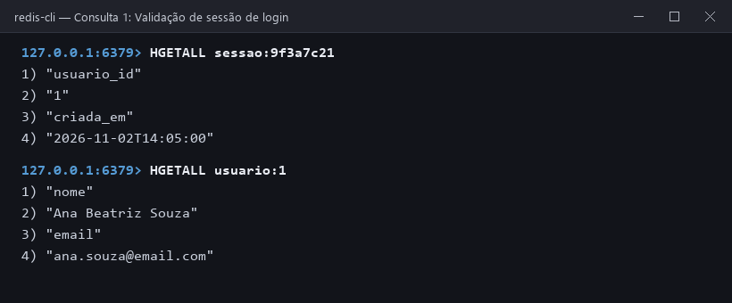
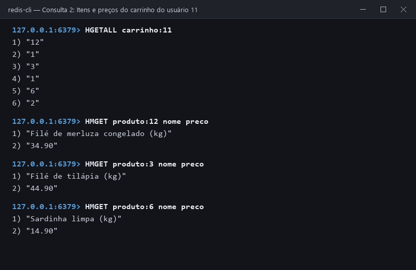
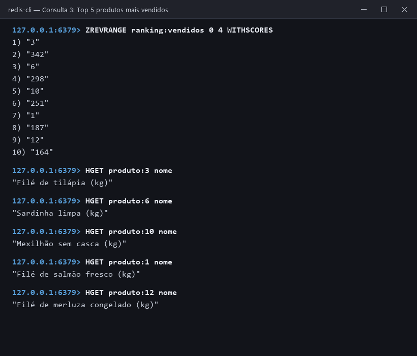
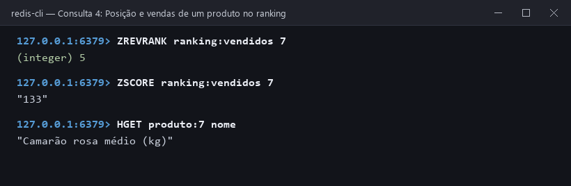
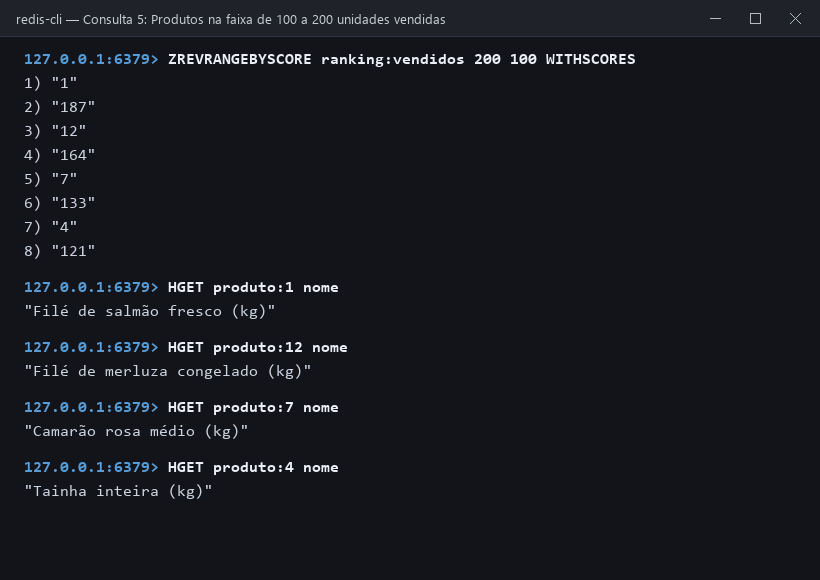
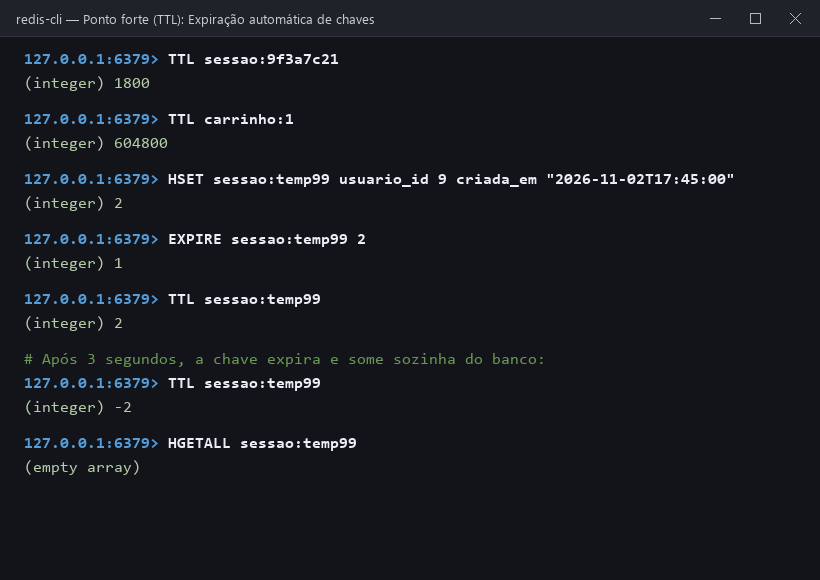

# Consultas do estudo de caso

As consultas abaixo respondem perguntas reais do e-commerce da peixaria sobre a base carregada por [`scripts/carga.redis`](../scripts/carga.redis). Todas podem ser executadas de uma vez com:

```bash
docker compose exec redis sh -c "redis-cli --raw < /scripts/consultas.redis"
```

---

## 1. Este token pertence a uma sessão válida? De qual cliente?

Quando o cliente faz uma requisição autenticada, o sistema recebe apenas o token (`9f3a7c21`) e precisa descobrir se a sessão ainda está ativa e quem é o usuário.

**Comando:**

```redis
HGETALL sessao:9f3a7c21
HGETALL usuario:1
```

**Como funciona:** o primeiro `HGETALL` acessa a sessão diretamente pela chave em $O(1)$ e retorna o `usuario_id` (`1`) e o horário de login. Com esse ID, o segundo `HGETALL` busca os dados da cliente (*Ana Beatriz Souza*). Se a sessão já tivesse passado de 30 minutos, a chave não existiria mais e o retorno seria vazio.

**Resultado:**



---

## 2. O que tem no carrinho do usuário 11 e quanto custa cada item?

Ao abrir a tela do carrinho da cliente 11 (*Larissa Gomes*), o sistema precisa listar os produtos escolhidos, as quantidades e os respectivos nomes e preços unitários.

**Comando:**

```redis
HGETALL carrinho:11
HMGET produto:12 nome preco
HMGET produto:3 nome preco
HMGET produto:6 nome preco
```

**Como funciona:** `HGETALL carrinho:11` devolve todos os pares `produto_id` → `quantidade` em uma única leitura (`12` com `1` un., `3` com `1` un. e `6` com `2` un.). Em seguida, `HMGET` busca apenas os campos necessários (`nome` e `preco`) de cada produto para montar o resumo do pedido:
- 1x Filé de merluza congelado (kg) — R\$ 34,90
- 1x Filé de tilápia (kg) — R\$ 44,90
- 2x Sardinha limpa (kg) — R\$ 14,90 cada (R\$ 29,80)

**Resultado:**



---

## 3. Quais são os 5 produtos mais vendidos da peixaria?

A vitrine principal do site exibe o "Top 5 mais vendidos" atualizado em tempo real a cada compra concluída.

**Comando:**

```redis
ZREVRANGE ranking:vendidos 0 4 WITHSCORES
HGET produto:3 nome
HGET produto:6 nome
HGET produto:10 nome
HGET produto:1 nome
HGET produto:12 nome
```

**Como funciona:** como o `ranking:vendidos` é um *Sorted Set* alimentado por `ZINCRBY` no fechamento de cada venda, os produtos já estão permanentemente ordenados pelo número de unidades vendidas (*score*). O comando `ZREVRANGE ... 0 4 WITHSCORES` lê os 5 primeiros do maior para o menor sem precisar somar nem ordenar histórico de vendas na hora da leitura:
1. **Filé de tilápia (kg)** (`produto:3`) — 342 vendidos
2. **Sardinha limpa (kg)** (`produto:6`) — 298 vendidos
3. **Mexilhão sem casca (kg)** (`produto:10`) — 251 vendidos
4. **Filé de salmão fresco (kg)** (`produto:1`) — 187 vendidos
5. **Filé de merluza congelado (kg)** (`produto:12`) — 164 vendidos

**Resultado:**



---

## 4. Em que posição está o "Camarão rosa médio (kg)" no ranking e quanto vendeu?

Na página de detalhes de um produto ou no painel do gerente, o sistema mostra a colocação específica daquele item no ranking geral.

**Comando:**

```redis
ZREVRANK ranking:vendidos 7
ZSCORE ranking:vendidos 7
HGET produto:7 nome
```

**Como funciona:** `ZREVRANK` retorna o índice do membro em ordem decrescente (base zero) diretamente da estrutura do *Sorted Set*, sem percorrer a lista inteira. O índice `5` significa que o **Camarão rosa médio (kg)** (`produto:7`) é o **6º produto mais vendido**, com **133 unidades** (`ZSCORE`).

**Resultado:**



---

## 5. Quais produtos venderam entre 100 e 200 unidades?

Para planejar a reposição de estoque de itens de giro intermediário, a peixaria consulta quais produtos estão na faixa de 100 a 200 unidades vendidas.

**Comando:**

```redis
ZREVRANGEBYSCORE ranking:vendidos 200 100 WITHSCORES
HGET produto:1 nome
HGET produto:12 nome
HGET produto:7 nome
HGET produto:4 nome
```

**Como funciona:** além de buscar por posição (`0 4`), o *Sorted Set* permite filtrar direto por intervalo de pontuação (*score*). `ZREVRANGEBYSCORE ranking:vendidos 200 100 WITHSCORES` traz em ordem decrescente os produtos nessa faixa de vendas:
- **Filé de salmão fresco (kg)** (`produto:1`) — 187 vendidos
- **Filé de merluza congelado (kg)** (`produto:12`) — 164 vendidos
- **Camarão rosa médio (kg)** (`produto:7`) — 133 vendidos
- **Tainha inteira (kg)** (`produto:4`) — 121 vendidos

**Resultado:**



---

## Recurso ponto forte do tipo chave-valor: Expiração automática (TTL)

Em bancos chave-valor voltados a sessão e cache como o Redis, o ciclo de vida do dado fica na própria chave por meio do **TTL (*Time To Live*)**. Tanto as sessões de login (30 minutos = `1800` segundos) quanto os carrinhos de compras (7 dias = `604800` segundos) recebem validade com `EXPIRE`.

Quando o tempo chega a zero, o próprio motor do Redis apaga a chave automaticamente, sem exigir *triggers*, rotinas agendadas (*cron jobs*) fazendo `DELETE WHERE expira_em < NOW()`, nem filtros de data nas consultas de leitura.

**Comando:**

```redis
TTL sessao:9f3a7c21
TTL carrinho:1
HSET sessao:temp99 usuario_id 9 criada_em "2026-11-02T17:45:00"
EXPIRE sessao:temp99 2
TTL sessao:temp99
# Aguardando 3 segundos...
TTL sessao:temp99
HGETALL sessao:temp99
```

**Como funciona:**
1. `TTL sessao:9f3a7c21` e `TTL carrinho:1` mostram os segundos restantes de vida da sessão e do carrinho no banco.
2. Criamos uma sessão de teste (`sessao:temp99`) com validade de 2 segundos (`EXPIRE sessao:temp99 2`).
3. Após 3 segundos, `TTL sessao:temp99` retorna `-2` (código do Redis que indica que a chave não existe mais) e `HGETALL sessao:temp99` retorna vazio.

**Resultado:**


