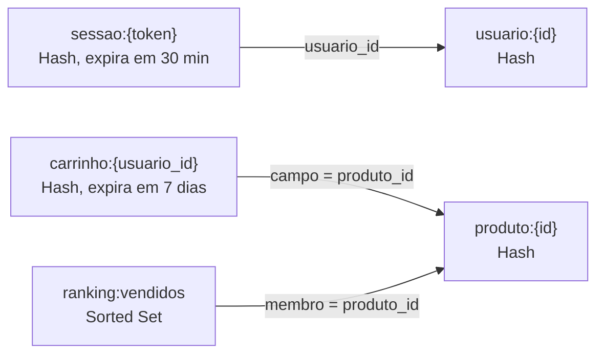

# Modelagem

Em chave-valor, o banco só encontra um dado rápido se o sistema já souber a chave. Por isso cada chave abaixo nasceu de uma pergunta que o sistema precisa responder.

## Como os dados ficam organizados



As setas são só convenção da aplicação: o Redis não conhece relacionamentos nem garante que o id apontado exista.

| Chave | Tipo | Conteúdo | Expiração |
|---|---|---|---|
| `usuario:{id}` | Hash | `nome`, `email` | Não expira |
| `produto:{id}` | Hash | `nome`, `preco`, `categoria` | Não expira |
| `sessao:{token}` | Hash | `usuario_id`, `criada_em` | 30 min, renovados a cada acesso |
| `carrinho:{usuario_id}` | Hash | Campo `produto_id`, valor quantidade | 7 dias, renovados a cada alteração |
| `ranking:vendidos` | Sorted Set | Membro `produto_id`, score unidades vendidas | Não expira |

Exemplo:

```
HSET sessao:a1b2c3 usuario_id 42 criada_em 2026-11-01T19:20:00
EXPIRE sessao:a1b2c3 1800

HSET carrinho:42 7 2 15 1
EXPIRE carrinho:42 604800

ZINCRBY ranking:vendidos 2 7
```

## Perguntas que o sistema precisa responder

| Pergunta | Comando | Como a modelagem ajuda |
|---|---|---|
| Este token é de uma sessão válida, e de quem? | `HGETALL sessao:{token}` | Acesso direto pela chave. Sessão vencida some sozinha, então não há limpeza nem comparação de datas. |
| Quanto tempo falta para a sessão expirar? | `TTL sessao:{token}` | O prazo fica na própria chave. |
| O que tem no carrinho do usuário? | `HGETALL carrinho:{usuario_id}` | Um Hash por usuário traz o carrinho inteiro em uma leitura, sem junção. |
| Como adicionar uma unidade de um produto ao carrinho? | `HINCRBY carrinho:{usuario_id} {produto_id} 1` | O incremento é atômico, então dois cliques seguidos não perdem unidade. |
| Quais são os 5 produtos mais vendidos? | `ZREVRANGE ranking:vendidos 0 4 WITHSCORES` | O Sorted Set se mantém ordenado a cada venda, então nada é ordenado na hora da leitura. |
| Em que posição está um produto no ranking? | `ZREVRANK ranking:vendidos {produto_id}` | A posição sai do próprio Sorted Set, sem percorrer a lista. |
| Qual o nome e o preço de um produto? | `HGETALL produto:{id}` | Completa as respostas do carrinho e do ranking, que guardam só o id. |

## O que esta modelagem não responde bem

Perguntas sem chave conhecida, como "quais carrinhos têm o produto 7?" ou "quanto foi vendido em outubro?". Responder exigiria percorrer as chaves ou criar uma estrutura nova para cada pergunta. Esse limite entra no comparativo com o relacional.
